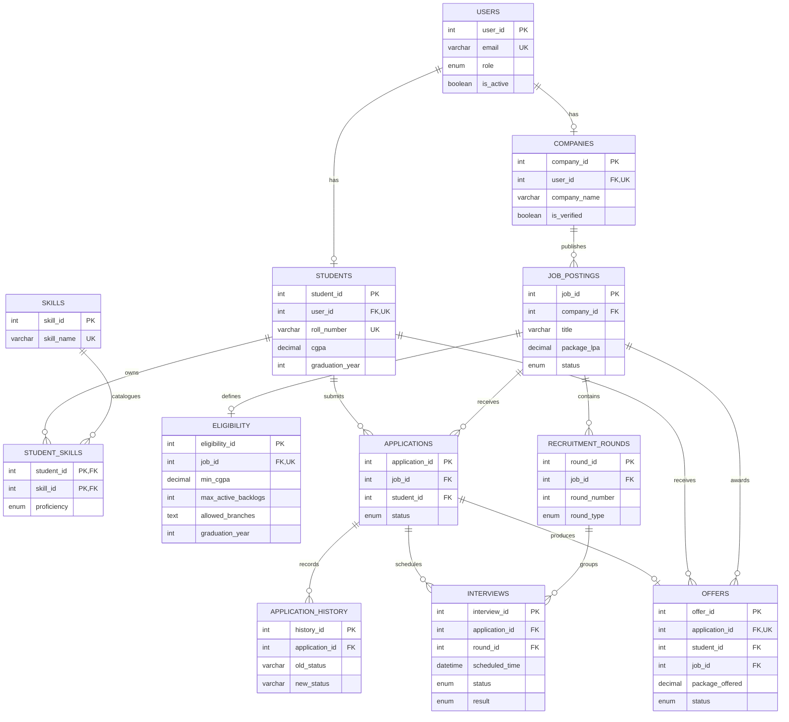
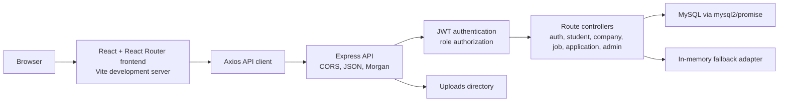

# SPARK

**Every placement, one platform.**
**Student Placement And Recruitment Kit**

[](./frontend/package.json)
[](./backend/package.json)
[](./database/schema.sql)
[](./backend/package.json)


> Screenshot captured from the repository. See [Screenshots](#screenshots) for the additional application view.

## Table of Contents

- [Overview](#overview)
- [Key Features](#key-features)
- [Database Design](#database-design)
- [System Architecture](#system-architecture)
- [Tech Stack](#tech-stack)
- [Getting Started](#getting-started)
- [Project Structure](#project-structure)
- [API Overview](#api-overview)
- [Screenshots](#screenshots)
- [Design System](#design-system)
- [Testing](#testing)
- [Roadmap](#roadmap)
- [Contributing, License, Authors](#contributing-license-authors)

## Overview

Campus placement work is often spread across spreadsheets, email threads, and
separate interview schedules. This makes eligibility checks, application
tracking, and placement reporting difficult to coordinate.

SPARK brings those workflows into one web application. Students can discover
drives and follow applications, recruiters can manage drives and candidates,
and placement officers can review approvals and institutional analytics.

The application has separate experiences for students, recruiters, and
placement officers. Authentication and role checks protect the role-specific
pages and API operations.

## Key Features

### Student

- Register and maintain an academic profile with branch, semester, CGPA, backlog, and graduation data.
- Browse approved recruitment drives with eligibility information.
- Apply to eligible drives and view application history and status.
- Upload a PDF resume and manage skills.
- View interview schedules and offer information.

### Recruiter

- Register and maintain a company profile.
- Create recruitment drives with package, deadline, eligibility, and interview rounds.
- Review applicants and update application status.
- Schedule candidate interviews and view recruiter dashboard statistics.

### Placement Officer/Admin

- View institutional placement analytics and branch comparisons.
- Review students and companies.
- Verify companies and approve or moderate job postings.
- Toggle user status and export a placement report as CSV.

## Database Design

SPARK uses a MySQL-compatible relational schema executed through the
`mysql2/promise` driver. The DDL defines 12 tables. The repository describes
the design as relational and uses bridge tables and foreign keys, but this
README does not claim a normal form because `eligibility.allowed_branches` is
stored as comma-separated text and therefore is not fully atomic.

### Entity relationship diagram



### Table summary

| Table | Purpose | Primary key | Important foreign keys |
|---|---|---|---|
| `users` | Authentication and role records | `user_id` | None |
| `students` | Academic and profile data | `student_id` | `user_id -> users` |
| `companies` | Recruiter organizations and verification | `company_id` | `user_id -> users` |
| `skills` | Skill catalogue | `skill_id` | None |
| `student_skills` | Student/skill many-to-many bridge | `(student_id, skill_id)` | `student_id -> students`, `skill_id -> skills` |
| `job_postings` | Recruitment drives and roles | `job_id` | `company_id -> companies` |
| `eligibility` | One eligibility record per drive | `eligibility_id` | `job_id -> job_postings` |
| `recruitment_rounds` | Interview stages for a drive | `round_id` | `job_id -> job_postings` |
| `applications` | Student applications and status | `application_id` | `job_id -> job_postings`, `student_id -> students` |
| `application_history` | Application status audit entries | `history_id` | `application_id -> applications` |
| `interviews` | Scheduled interviews | `interview_id` | `application_id -> applications`, `round_id -> recruitment_rounds` |
| `offers` | Final offers and package status | `offer_id` | `application_id -> applications`, `student_id -> students`, `job_id -> job_postings` |

### Integrity and business rules

The main constraints are defined in [database/schema.sql](./database/schema.sql):

- `users.email`, `students.user_id`, `students.roll_number`, `companies.user_id`,
  `skills.skill_name`, `eligibility.job_id`, and `offers.application_id` are unique.
- `applications (job_id, student_id)` prevents duplicate applications.
- `recruitment_rounds (job_id, round_number)` prevents duplicate round numbers within a drive.
- `CHECK` constraints validate email format, academic ranges, non-negative backlogs,
  positive packages, and positive round numbers.
- Foreign keys use `ON DELETE CASCADE` for dependent profile, application,
  interview, offer, and history records.

Triggers in [database/triggers.sql](./database/triggers.sql) provide:

- Application status audit entries in `application_history`.
- Placement status synchronization when an offer is accepted, declined, or revoked.
- Rejection of applications for unapproved or expired drives.
- CGPA bounds validation on student inserts.

For example, the application deadline trigger contains:

```sql
IF NOW() > v_deadline THEN
    SIGNAL SQLSTATE '45000'
    SET MESSAGE_TEXT = 'Application Error: Recruitment drive deadline has passed.';
END IF;
```

The procedures in [database/procedures.sql](./database/procedures.sql) define
transactional application and offer workflows, including rollback handlers:

```sql
DECLARE EXIT HANDLER FOR SQLEXCEPTION
BEGIN
    ROLLBACK;
    SET p_status_code = 500;
    SET p_message = 'Internal SQL Transaction Error. Rolled back.';
END;
```

The file also defines `sp_get_branch_placement_summary`. The current Node.js
controllers perform application and eligibility checks directly in JavaScript
and SQL; no `CALL` to these procedures was found in `backend/src`.

Five reporting views are defined in [database/views.sql](./database/views.sql):

- `vw_overall_placement_kpis`
- `vw_branch_wise_placements`
- `vw_company_drive_analytics`
- `vw_student_comprehensive_status`
- `vw_upcoming_interviews_calendar`

Twenty indexes are defined in [database/indexes.sql](./database/indexes.sql)
for role lookup, student filtering, drive status/deadline, application
pipelines, interview schedules, offers, and student skills.

Authentication roles are represented by the `users.role` enum:
`student`, `company`, and `admin`. Express middleware in
[backend/src/middleware/auth.js](./backend/src/middleware/auth.js) validates
JWTs and applies role authorization. Application status history is the
implemented audit log.

Database setup files:

- [database/schema.sql](./database/schema.sql)
- [database/indexes.sql](./database/indexes.sql)
- [database/sample_data.sql](./database/sample_data.sql)
- [database/triggers.sql](./database/triggers.sql)
- [database/procedures.sql](./database/procedures.sql)
- [database/views.sql](./database/views.sql)

## System Architecture



For a student application, the browser sends `POST /api/applications/apply`.
The route applies JWT and student-role middleware in
[backend/src/routes/application.routes.js](./backend/src/routes/application.routes.js).
`applyForJob` in
[backend/src/controllers/application.controller.js](./backend/src/controllers/application.controller.js)
loads the drive and eligibility data, checks approval and deadline, prevents
duplicates, evaluates the student profile, inserts the application, and
records initial history.

## Tech Stack

| Layer | Technology | Purpose |
|---|---|---|
| Frontend | React 18, React Router 6 | Single-page user interface and route composition |
| Frontend tooling | Vite 5 | Development server and production build |
| Styling | Tailwind CSS 3, PostCSS, Autoprefixer | Utility styling and theme tokens |
| Animation | Framer Motion | Animated background paths |
| Charts | Recharts | Admin placement charts |
| Icons | Lucide React | Interface icons |
| HTTP client | Axios | API requests and JWT interceptor |
| Backend | Node.js, Express 4 | REST API and middleware |
| Authentication | JSON Web Tokens, bcryptjs | Session tokens and password hashing |
| Database driver | mysql2/promise | MySQL connection pool and queries |
| Database | MySQL-compatible SQL, InnoDB | Relational persistence |
| Uploads | Multer | PDF resume upload handling |

## Getting Started

### Prerequisites

- Node.js and npm. Exact Node.js versions are not pinned in the repository.
- A MySQL-compatible server. The schema uses MySQL syntax and InnoDB; an exact
  server version is not declared in the repository.

### Configure the backend

```powershell
cd backend
Copy-Item .env.example .env
```

Set these variables in `backend/.env` using local values:

| Variable | Purpose | Repository default |
|---|---|---|
| `PORT` | Backend HTTP port | `5000` |
| `NODE_ENV` | Runtime environment | `development` |
| `DB_HOST` | MySQL host | `localhost` |
| `DB_PORT` | MySQL port | `3306` |
| `DB_USER` | MySQL user | `root` |
| `DB_PASSWORD` | MySQL password | TODO: provide locally |
| `DB_NAME` | Database name | `campushire_db` |
| `JWT_SECRET` | JWT signing secret | TODO: provide locally |
| `JWT_EXPIRES_IN` | JWT lifetime | `7d` |
| `UPLOAD_DIR` | Upload directory setting | `uploads` |

Do not commit `.env` or real credentials.

### Install dependencies

```powershell
cd backend
npm install

cd ..\frontend
npm install
```

### Create the database

The repository bootstrap command creates the configured database and executes
`schema.sql`, `indexes.sql`, and `sample_data.sql`:

```powershell
cd backend
npm run db:init
```

The bootstrap does not execute triggers, stored procedures, or views. To install
those additional SQL objects after the bootstrap, use a MySQL client with the
same configured database:

```powershell
Get-Content ..\database\triggers.sql -Raw | mysql -h localhost -P 3306 -u root -p campushire_db
Get-Content ..\database\procedures.sql -Raw | mysql -h localhost -P 3306 -u root -p campushire_db
Get-Content ..\database\views.sql -Raw | mysql -h localhost -P 3306 -u root -p campushire_db
```

### Start the services

Backend development server, on port `5000`:

```powershell
cd backend
npm run dev
```

Backend production-style start:

```powershell
cd backend
npm start
```

Frontend development server, on port `3000`, with `/api` and `/uploads`
proxied to the backend:

```powershell
cd frontend
npm run dev
```

Frontend production build:

```powershell
cd frontend
npm run build
```

The backend health endpoint is `http://localhost:5000/api/health`.

### Seed data

The seed file defines demonstration users for student, company, and admin
roles. Credentials are intentionally not reproduced here; inspect
[database/sample_data.sql](./database/sample_data.sql) in a local development
environment if you are authorized to use the demo data.

## Project Structure

```text
SPARK/
├── backend/
│   ├── src/
│   │   ├── config/          # Database connection and bootstrap
│   │   ├── controllers/     # Auth, student, company, job, application, admin
│   │   ├── middleware/      # JWT and role authorization
│   │   ├── routes/          # Express route definitions
│   │   └── server.js        # Express entry point
│   ├── test/                # Backend integration test
│   ├── .env.example         # Environment template
│   └── package.json
├── database/
│   ├── schema.sql           # 12-table DDL
│   ├── sample_data.sql      # Seed records
│   ├── indexes.sql          # Query indexes
│   ├── triggers.sql         # Database triggers
│   ├── procedures.sql       # Stored procedures
│   └── views.sql            # Reporting views
├── documentation/
│   └── PROJECT_REPORT.md    # Existing academic report
├── frontend/
│   ├── src/
│   │   ├── components/      # Shared layout and UI components
│   │   ├── context/         # Authentication context
│   │   ├── pages/           # Public and role-specific pages
│   │   ├── services/        # Axios API client
│   │   └── config/          # Central brand constants
│   ├── public/              # Static favicon
│   └── package.json
├── screenshots/              # Captured application screenshots
├── package.json              # Root dependency manifest
└── README.md
```

## API Overview

All API paths are mounted under `/api`. The complete definitions are in
[backend/src/routes](./backend/src/routes).

| Method | Path | Purpose | Required role |
|---|---|---|---|
| `GET` | `/api/health` | Report API and database adapter status | Public |
| `POST` | `/api/auth/register/student` | Register a student | Public |
| `POST` | `/api/auth/register/company` | Register a recruiter | Public |
| `POST` | `/api/auth/login` | Authenticate and issue a JWT | Public |
| `GET` | `/api/auth/me` | Read the authenticated profile | Authenticated |
| `GET` | `/api/jobs` | List drives with optional personalized eligibility | Public or authenticated |
| `GET` | `/api/jobs/:jobId` | Read a drive | Public or authenticated |
| `POST` | `/api/applications/apply` | Submit a student application | Student |
| `GET` | `/api/students/profile` | Read student profile | Student |
| `PUT` | `/api/students/profile` | Update student profile | Student |
| `POST` | `/api/students/resume` | Upload a PDF resume | Student |
| `GET` | `/api/students/applications` | List student applications | Student |
| `GET` | `/api/students/interviews` | List student interviews | Student |
| `GET` | `/api/companies/jobs` | List recruiter drives | Recruiter |
| `POST` | `/api/companies/jobs` | Create a drive | Recruiter |
| `GET` | `/api/companies/jobs/:jobId/applicants` | Read drive applicants | Recruiter |
| `PUT` | `/api/companies/applications/:applicationId/status` | Update applicant status | Recruiter |
| `POST` | `/api/companies/interviews` | Schedule an interview | Recruiter |
| `GET` | `/api/admin/analytics` | Read placement KPIs | Admin |
| `GET` | `/api/admin/students` | Read student directory | Admin |
| `PUT` | `/api/admin/companies/:companyId/verify` | Verify a company | Admin |
| `PUT` | `/api/admin/jobs/:jobId/status` | Moderate a drive | Admin |
| `GET` | `/api/admin/report` | Generate placement report data | Admin |

## Screenshots


*Landing page with the SPARK wordmark, hero copy, actions, and placement statistics.*


*Student drive browser showing search, eligibility information, and drive cards.*

## Design System

The frontend uses CSS custom-property theme tokens exposed through Tailwind,
with light and class-based dark modes. The application loads Raleway for the
primary interface font; the `font-mono` token is mapped to the same Raleway
font in the current theme.

## Testing

Backend integration tests are defined in
[backend/test/api.test.js](./backend/test/api.test.js) and run with:

```powershell
cd backend
npm test
```

The test script starts the API on port `5055` and covers the health endpoint,
student/company/admin login, student profile access, personalized job
eligibility, admin analytics, and the student-to-admin authorization barrier.
No frontend test script is defined in `frontend/package.json`.

## Roadmap

The existing academic report identifies these future-scope items:

- AI resume screening.
- An online assessment sandbox with code execution and plagiarism detection.
- Automated WhatsApp or email alerts.
- An alumni mentorship network.

These are documented future ideas, not implemented features.

## Contributing, License, Authors

No contribution guide is present. For changes, keep frontend and backend
responsibilities separate, preserve API contracts, and update the relevant SQL
or route documentation when behavior changes.

**License:** [ISC](./LICENSE).

**Author:** Krissh360
