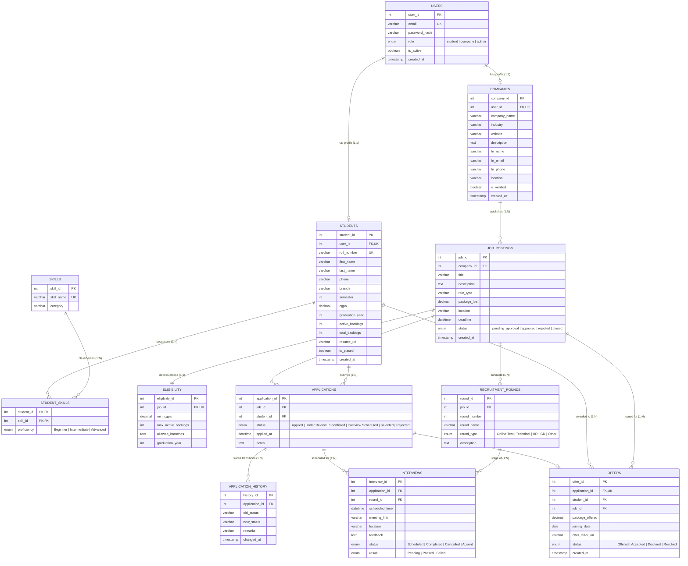

# SPARK — Student Placement And Recruitment Kit
## Comprehensive DBMS Academic Project Documentation & Technical Report

---

### 1. Project Abstract
**SPARK (Student Placement And Recruitment Kit)** is an enterprise-grade, full-stack campus placement and recruitment management web application designed to digitize and automate the entire collegiate recruitment workflow. It connects three primary stakeholders: **Students**, **Corporate Recruiters (Companies)**, and **Placement Officers (Administrators)**.

Built on a strictly normalized MySQL relational database (3NF), Node.js/Express REST backend, and a modern React.js frontend, SPARK provides automated academic eligibility checking, multi-round interview tracking, application audit logging, dynamic offer generation, and institutional placement business intelligence.

---

### 2. Problem Statement
Traditional collegiate placement processes suffer from significant operational inefficiencies:
- **Manual Eligibility Filtering**: Placement cells manually parse spreadsheets to verify whether candidates meet CGPA cutoffs, branch criteria, and backlog limits, leading to human error and delayed shortlisting.
- **Data Redundancy & Anomalies**: Disjointed tracking systems create data duplication, inconsistent candidate records, and lack of historical audit trails when application statuses change.
- **Lack of Transparency**: Students remain unaware of why they were deemed ineligible or what stage their application has reached.
- **Reporting Overhead**: Generating university accreditation reports (e.g., NAAC, NIRF) requires weeks of manual data compilation across engineering departments.

---

### 3. Project Objectives
1. **Relational Database Design**: Design and implement a properly normalized (3NF) relational database adhering to entity-relationship integrity, foreign key cascading, check constraints, and performance indexes.
2. **Automated Eligibility Engine**: Dynamically evaluate candidate eligibility against job-specific criteria (CGPA cutoff, allowed engineering branches, maximum active backlogs, and graduation year).
3. **Multi-Stage Recruitment Lifecycle**: Model complex recruitment funnels featuring custom recruitment rounds (Online Assessments, Technical Interviews, HR Rounds) and real-time candidate status updates.
4. **Audit Trail & Integrity**: Maintain complete temporal history of application transitions using database triggers and transactional stored procedures.
5. **Institutional Business Intelligence**: Provide placement officers with real-time visual dashboards (branch-wise placement rates, compensation benchmarks, and top recruiting partners) and exportable reports.

---

### 4. Requirements Specification

#### 4.1 Functional Requirements
- **Authentication & RBAC**: Secure JWT-based authentication with bcrypt password hashing; role-based route protection for Student, Company, and Admin.
- **Student Profile Management**: Academic details tracking (USN roll number, branch, semester, CGPA, graduation batch, active/total backlogs) and technical skills tagging.
- **Resume Handling**: PDF resume upload, verification, and recruiter preview.
- **Recruitment Drive Management**: Recruiter creation of job postings with granular eligibility criteria and interview rounds.
- **Application Pipeline**: Single-click application submission with duplicate prevention and eligibility enforcement.
- **Interview Scheduling**: Recruiter scheduling of candidate interview slots with virtual meeting links and feedback recording.
- **Offer Issuance**: Automatic student placement synchronization and offer letter generation upon final candidate selection.
- **Admin Governance**: Verification of recruiting partner organizations, moderation of job drives, and user account status toggling.
- **Report Generation**: Instant synthesis and CSV export of university placement reports.

#### 4.2 Non-Functional Requirements
- **Security**: Passwords hashed with bcrypt (salt rounds = 10); API endpoints protected via JWT Bearer authentication; declarative CHECK constraints against SQL injection vectors.
- **Performance**: Sub-100ms API query response times using dedicated B-Tree indexes on search keys, foreign keys, and status flags.
- **Scalability**: Connection pooling via `mysql2` supporting concurrent database connections.
- **Usability**: Responsive SaaS-style user interface built with Tailwind CSS, Lucide icons, and Recharts.

---

### 5. Entity-Relationship (ER) Diagram

---

### 6. Relational Schema & 3NF Normalization Breakdown

#### 6.1 Formal Relational Schema Notation
- `users`(**user_id**, *email*, password_hash, role, is_active, created_at, updated_at)
- `students`(**student_id**, *user_id*, *roll_number*, first_name, last_name, phone, branch, semester, cgpa, graduation_year, active_backlogs, total_backlogs, resume_url, is_placed, created_at, updated_at)
- `companies`(**company_id**, *user_id*, company_name, industry, website, description, hr_name, hr_email, hr_phone, location, is_verified, created_at, updated_at)
- `skills`(**skill_id**, *skill_name*, category)
- `student_skills`(**student_id, skill_id**, proficiency)
- `job_postings`(**job_id**, *company_id*, title, description, role_type, package_lpa, location, deadline, status, created_at, updated_at)
- `eligibility`(**eligibility_id**, *job_id*, min_cgpa, max_active_backlogs, allowed_branches, graduation_year)
- `recruitment_rounds`(**round_id**, *job_id*, round_number, round_name, round_type, description)
- `applications`(**application_id**, *job_id*, *student_id*, status, applied_at, notes)
- `application_history`(**history_id**, *application_id*, old_status, new_status, remarks, changed_at)
- `interviews`(**interview_id**, *application_id*, *round_id*, scheduled_time, meeting_link, location, feedback, status, result, created_at, updated_at)
- `offers`(**offer_id**, *application_id*, *student_id*, *job_id*, package_offered, joining_date, offer_letter_url, status, created_at, updated_at)

#### 6.2 Normalization Analysis
1. **First Normal Form (1NF)**:
   - All columns hold strictly atomic values.
   - Repeating multi-valued attributes (e.g. skills possessed by a student) are factored out into the associative table `student_skills`.
   - Every relation defines a primary key constraint.
2. **Second Normal Form (2NF)**:
   - The relations satisfy 1NF.
   - In composite primary key tables such as `student_skills(student_id, skill_id)`, non-key attributes (`proficiency`) exhibit full functional dependency on the entire composite key $\{ \text{student\_id}, \text{skill\_id} \}$, with no partial dependencies. All single-attribute primary key tables automatically satisfy 2NF.
3. **Third Normal Form (3NF)**:
   - The relations satisfy 2NF.
   - There are no transitive functional dependencies ($X \to Y$ and $Y \to Z$).
   - Universal user credentials reside strictly in `users`. Recruiter-specific business metadata resides in `companies`, and academic metrics reside in `students`. Eligibility cutoff rules are separated into `eligibility`, ensuring attributes depend solely on the primary key.

---

### 7. Data Dictionary

| Table Name | Column Name | Data Type | Nullable | Key / Constraint | Description |
| :--- | :--- | :--- | :--- | :--- | :--- |
| `users` | `user_id` | INT | NO | PRIMARY KEY | Unique user identifier |
| `users` | `email` | VARCHAR(100) | NO | UNIQUE, CHECK | User login email address |
| `users` | `password_hash` | VARCHAR(255) | NO | None | bcrypt hashed password |
| `users` | `role` | ENUM | NO | 'student','company','admin' | User access authorization role |
| `students` | `student_id` | INT | NO | PRIMARY KEY | Unique student profile ID |
| `students` | `user_id` | INT | NO | FOREIGN KEY -> users | Associated user account |
| `students` | `roll_number` | VARCHAR(50) | NO | UNIQUE | College USN / Roll number |
| `students` | `cgpa` | DECIMAL(3,2) | NO | CHECK (0.00-10.00) | Cumulative Grade Point Average |
| `students` | `is_placed` | BOOLEAN | NO | DEFAULT FALSE | Placement confirmation flag |
| `job_postings`| `job_id` | INT | NO | PRIMARY KEY | Unique recruitment drive ID |
| `job_postings`| `company_id` | INT | NO | FOREIGN KEY -> companies | Recruiter organization |
| `job_postings`| `package_lpa`| DECIMAL(5,2) | NO | CHECK (> 0.00) | Annual CTC package in Lakhs |
| `eligibility` | `min_cgpa` | DECIMAL(3,2) | NO | CHECK (0.00-10.00) | Minimum CGPA cutoff |
| `applications`| `status` | ENUM | NO | DEFAULT 'Applied' | Application pipeline stage |
| `offers` | `package_offered`| DECIMAL(5,2)| NO | CHECK (> 0.00) | Final negotiated CTC package |

---

### 8. REST API Reference

| Method | Endpoint | Access Role | Description |
| :--- | :--- | :--- | :--- |
| `POST` | `/api/auth/register/student` | Public | Register new student profile |
| `POST` | `/api/auth/register/company` | Public | Register new recruiter organization |
| `POST` | `/api/auth/login` | Public | Authenticate user & issue JWT |
| `GET` | `/api/auth/me` | Authenticated | Retrieve authenticated user profile |
| `GET` | `/api/jobs` | Public / Student | List jobs with dynamic eligibility |
| `POST` | `/api/applications/apply` | Student | Submit job application with checks |
| `GET` | `/api/students/profile` | Student | Fetch academic record & skills |
| `PUT` | `/api/students/profile` | Student | Update phone, branch, CGPA |
| `POST` | `/api/students/resume` | Student | Upload official PDF resume |
| `GET` | `/api/companies/jobs` | Company | List company drives & applicants |
| `POST` | `/api/companies/jobs` | Company | Create drive with criteria & rounds |
| `PUT` | `/api/companies/applications/:id/status`| Company | Update status (Shortlist/Select) |
| `POST` | `/api/companies/interviews` | Company | Schedule candidate interview slot |
| `GET` | `/api/admin/analytics` | Admin | Overall KPIs & branch breakdown |
| `GET` | `/api/admin/students` | Admin | Directory with user status toggle |
| `PUT` | `/api/admin/companies/:id/verify` | Admin | Verify recruiting partner |
| `GET` | `/api/admin/report` | Admin | Master tabular placement report |

---

### 9. SQL Features & Demonstrations

The database implementation demonstrates:
- **DDL**: `CREATE TABLE`, `ALTER TABLE` (column additions, check constraints), `DROP TABLE` in `database/schema.sql` and `database/queries.sql`.
- **DML**: `INSERT INTO ... ON DUPLICATE KEY UPDATE`, `UPDATE`, and `DELETE` operations.
- **DQL**: Multi-table `INNER JOIN`, `LEFT JOIN`, and `RIGHT JOIN` correlating students, jobs, interviews, and offers.
- **Aggregates & Grouping**: `COUNT()`, `SUM()`, `AVG()`, `MAX()`, `MIN()` grouped by branch with `HAVING` filters on competitive salary thresholds.
- **Nested & Subqueries**: Scalar subqueries (CGPA above college average), `IN` subqueries, and `NOT EXISTS` correlated subqueries.
- **Database Views**: 5 production views defined in `database/views.sql` (`vw_overall_placement_kpis`, `vw_branch_wise_placements`, `vw_company_drive_analytics`, `vw_student_comprehensive_status`, `vw_upcoming_interviews_calendar`).
- **Stored Procedures**: ACID transactions and eligibility validation in `sp_apply_job_with_eligibility_check` and `sp_update_application_status_and_offer`.
- **Triggers**: Automated audit logging in `trg_after_application_status_update`, synchronization in `trg_after_offer_status_update`, and deadline validation in `trg_prevent_application_past_deadline`.

---

### 10. Future Scope & Roadmap
1. **AI Resume Screening**: Natural Language Processing (NLP) integration to parse resume keywords and rank candidates against job descriptions.
2. **Automated Online Assessment Sandbox**: In-browser coding compiler with real-time testcase execution and plagiarism detection.
3. **Automated WhatsApp / Email Alerts**: Push notifications for interview schedules, shortlist announcements, and offer letters.
4. **Alumni Mentorship Network**: Connecting placed seniors with juniors for interview preparation and referrals.
